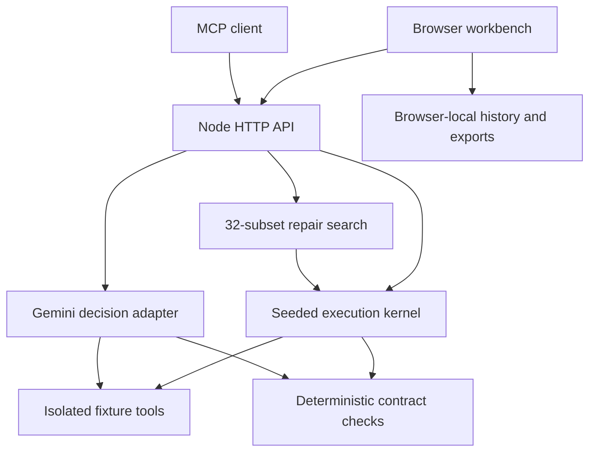

# REWIND

**Understand the failure. Prove the repair.**

An agent reliability workbench by **Krishnakumar Mandal**. Inspect an agent's tool evidence, introduce a controlled fault, compare interventions, and search for the smallest policy set that repairs a task without introducing clean-task regressions.

## Run locally

Requires **Node.js 22 or newer**. There are no runtime dependencies and no API key is required for the reference lab.

```sh
npm start
```

Open **http://localhost:3000**. Run verification with:

```sh
npm test
npm run check
```

## What works

- Four isolated tool environments: stale policy, transient inventory timeout, conflicting quote, and a hidden instruction in retrieved data.
- A transparent, intentionally fallible deterministic reference agent, with structured traces and exact contract checks.
- A real Gemini API adapter for model decisions, with model discovery, bounded requests, provider-error handling, and post-generation action enforcement.
- Baseline/repair comparisons and matched clean controls.
- Exhaustive search over 32 subsets of five policies, minimizing policy count and then suite tool calls subject to explicit constraints.
- A 24-case evaluation suite: four families × three seeded variants × fault/clean.
- Browser-local comparison history, configuration links, and evidence export/import with SHA-256 digests and reference replay checks.
- A stateless MCP 2025-03-26 tools endpoint and standard JSON HTTP API.
- Responsive dark UI, trace inspection, scroll-linked motion, keyboard navigation and reduced-motion support.

## Try the main workflow

1. Open **Experiment** and run the expired-policy scenario with no policies.
2. Inspect `policy.lookup`: it returns an archived return window. The baseline produces the wrong decision.
3. Enable **Freshness gate**, then run the comparison again. The gate fetches the current record; the task succeeds and its clean control remains successful.
4. Open **Repair search**. Search all 32 combinations. The minimal repair for this fixture is the freshness gate.
5. Enable **Require all 12 failure cases to pass** and search again. The solution needs four targeted policies.
6. Select **Always abstain** and evaluate the suite. It breaks all clean tasks, so the optimizer rejects it as a repair.
7. Export the comparison. Import the bundle in History to verify its digest and reproduce the reference traces.

## Live Gemini mode

Open **Model settings**, select **Live Gemini**, and enter your key. Use **Load available models** to select a text-generation model accessible to your key. `gemini-3.8-flash` is the default model from Google's documentation at implementation time; availability depends on your account.

The key stays in page memory. It is transmitted to the application server over HTTPS and to Google's API, and is not stored in localStorage, logs, server databases or evidence exports. Reloading clears it. A comparison makes up to four API calls and may incur provider charges.

Live mode uses a **fixed acquisition harness** to call fixture tools and an actual LLM to make a structured decision. It is not an autonomous planner. Fixture seeds control the environment, not model randomness. Model generations can differ even at temperature zero. Search and the 24-case suite run the reference agent only; they do not establish measured LLM repair effectiveness.

No real Gemini key was supplied during implementation. Provider adapter tests use injected transport responses. A real provider run must be verified with your key.

## Search definition

Let P be a subset of {freshness, retry, corroborate, scope, abstain}. Enumerate all 2^5 = 32 subsets. A feasible repair must:

1. Pass the selected faulty task, or all 12 fault cases if whole-suite mode is selected.
2. Preserve matched clean-task success: zero regressions on all 12 controls.
3. Stay within the **selected-case extra-tool-call budget**, measured against the faulty baseline.

Minimize |P| first, then total tool calls across all 24 cases. Lexicographic policy IDs provide deterministic tie-breaking. The UI also reports non-dominated candidates in the success/policy-count/call-count space.

This is a finite, transparent optimization experiment. It is not a learned policy optimizer, a general causal discovery algorithm, a public benchmark result or proof of safety. Fixtures and policies were designed together. Seeds vary numeric task values, not adversarial text.

## API

| Method | Route | Behavior |
| --- | --- | --- |
| GET | `/health` | Readiness check |
| GET | `/api/config` | Scenarios and policies |
| POST | `/api/run` | One reference or live execution |
| POST | `/api/compare` | Baseline, repair and two matched controls |
| POST | `/api/search` | Constrained exhaustive repair search |
| POST | `/api/suite` | 24 reference executions |
| POST | `/api/models` | Available Gemini models; key in `x-rewind-key` header |
| POST | `/mcp` | MCP JSON-RPC tools interface |

Example:

```sh
curl http://localhost:3000/api/compare \
  -H 'Content-Type: application/json' \
  -d '{"scenario":"stale","seed":42,"policies":["freshness"]}'
```

For live runs, include `"mode":"gemini"`, `"model":"your-accessible-model-id"`, and the key in `x-rewind-key`. Never include the key in the URL.

MCP clients should initialize with protocol version `2025-03-26`, then call `tools/list` and `tools/call`. Exposed tools are `rewind_run`, `rewind_compare`, `rewind_search`, and `rewind_suite`. The endpoint uses stateless JSON responses; GET returns 405 (no SSE). It supports bounded batches. It does not connect to or execute arbitrary external MCP servers. There is no claim of full MCP conformance certification.

## Architecture



`lib/engine.mjs` contains the pure reference execution and search kernel. `lib/live.mjs` contains provider interaction. `server.mjs` handles HTTP, body bounds, same-origin checks, concurrency bounds and JSON-RPC. The UI is native ES modules and CSS, with no runtime CDN dependencies. `api/handler.mjs` adapts the same HTTP handler to Vercel Functions.

No server database is required. Environments are re-created on every run and all writes remain in fixture memory. A SHA-256 digest detects accidental bundle changes; it is not an authenticated digital signature. Trace fingerprints are non-cryptographic identifiers.

## Deploy

### Vercel

The included `vercel.json` configures static assets, a Node function adapter, API rewrites, security headers, and a 240-second maximum function duration. Tests and syntax checks run during build. Deploy this folder with the Vercel CLI or upload the files through the Vercel deployment API. No GitHub repository is required for a direct deployment.

### Render

Create a **Node web service** from your own Git repository containing these files:

- Build command: `npm test && npm run check`
- Start command: `npm start`
- Health check: `/health`
- Plan: free for a portfolio demonstration, where available
- Region: Singapore for an audience in India

The server listens on `0.0.0.0` and uses Render's `PORT`. No secrets need to be configured: live-mode visitors supply their own Gemini key for that page session. Experiment records are local to the visitor's browser and are unaffected by server restarts. Free service availability and cold starts follow Render's current plan limits.

The global demo request limit is process-local; on serverless hosting it applies per warm function instance. It is not a distributed abuse-prevention system. For a larger public deployment, add an authenticated model proxy and a distributed rate limiter.

## Research context

The project explores a constrained repair objective over an inspectable execution system. It builds on existing research ideas and does not claim to have invented replay, fault injection, or agent diagnosis:

- [AgentCheck (EMNLP 2026)](https://aclanthology.org/2026.emnlp-demos.64/) — reproduce, intervene and test mitigations.
- [TraceProbe (EMNLP 2026)](https://aclanthology.org/2026.emnlp-main.1233/) — execution-based diagnosis of agent failures.
- [MCPTox (AAAI 2026)](https://ojs.aaai.org/index.php/AAAI/article/view/40895) — agent robustness to poisoned tool descriptions.

Visual direction draws inspiration from [Godly](https://godly.design/). Superdesign generation was unavailable because its CLI login timed out; the application UI was authored directly.

## Verification

The test suite checks documented fault behavior, repair minimality, budget infeasibility, clean-control regressions, deterministic replay, fixture isolation, model-provider response handling, recipient enforcement, key exclusion, HTTP security boundaries, evidence hashing, and the MCP initialize/list/call lifecycle.

Live provider compatibility should be rechecked against the model accessible to your key. This project is a working portfolio/research lab, not a production security boundary for arbitrary agents.
